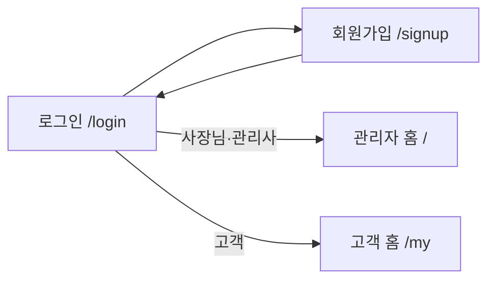
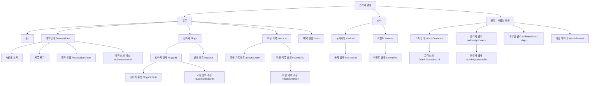
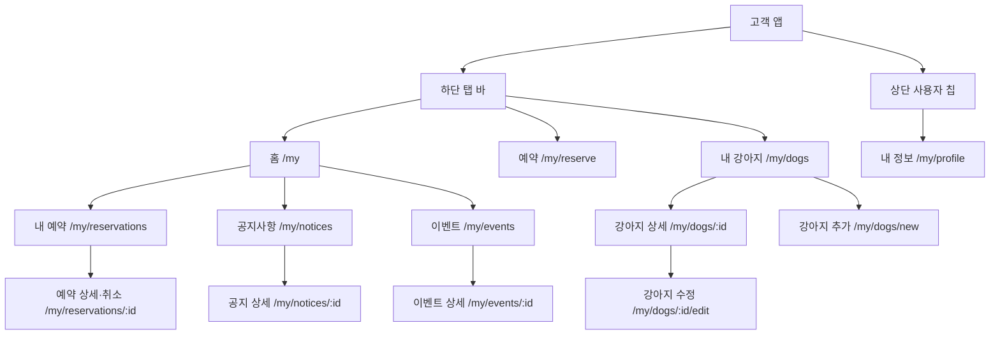

# 몽실 미용실 Level 3 메뉴 구조도 (Information Architecture) v1.0

> 2026.10.28 · 현재 구현된 화면 기준 (주소는 실제 앱의 경로)
> 같은 내용의 문서: **엑셀 `몽실미용실_메뉴구조도_IA_v1.0.xlsx`(화면 목록의 원본)**, PPT `몽실미용실_메뉴구조도_IA_v1.0.pptx`(그림), 각각의 PDF. 모든 문서는 항상 같은 내용을 유지합니다.

## 1. 구조 개요

| 영역 | 사용자 | 진입 주소 | 내비게이션 |
|---|---|---|---|
| 공개 영역 | 로그인 전 | `/login` | 없음 (로그인 ↔ 회원가입) |
| 관리자 콘솔 (Admin Console) | 사장님(총관리자) · 관리사(일반관리자) | `/` | 좌측 사이드바 (모바일: 햄버거) |
| 고객 앱 (Customer App) | 고객 | `/my` | 하단 탭 바 + 상단 사용자 칩 |

- **계층(Depth) 규칙:** Depth 1 = 메뉴, Depth 2 = 목록, Depth 3 = 상세·등록·수정
- **로그인 후 첫 화면:** 총관리자·일반관리자 → `/`, 고객 → `/my`
- **화면 수:** 총 40개 (공개 2 · 관리자 공통 19 · 사장님 전용 6 · 고객 13). 예약관리의 시간표·목록은 한 주소(`/reservations`)의 두 보기입니다.
- **원칙:** 눌러서 볼 내용이 있는 목록에는 상세 화면을 두고, 볼 내용이 없는 목록(휴무일 관리)에는 두지 않습니다.

## 2. 사이트맵

### 2.1 공개 영역

### 2.2 관리자 콘솔 — 사장님 (총관리자)

### 2.3 관리자 콘솔 — 관리사 (일반관리자)

사장님과 **업무 · 소식** 메뉴는 같고, **관리(사장님 전용) 그룹은 보이지 않습니다.** 주소로 직접 들어와도 "사장님만 쓸 수 있는 화면이에요" 안내만 나옵니다.

### 2.4 고객 앱

- 내 예약·공지·이벤트는 탭에 없고 **홈에서 들어갑니다.** (해당 화면에서는 홈 탭이 켜진 상태로 표시)

## 3. 권한 매트릭스

| 메뉴 / 화면 | 사장님 | 관리사 | 고객 |
|---|---|---|---|
| 홈 (현황 카드) | ✔ (매출 포함) | ✔ (매출 제외) | — (고객 홈) |
| 예약 현황 (카드 선택 → 그래프) | ✔ (매출 그래프 포함) | ✔ (매출 제외) | — |
| 예약관리 · 예약 신청 · 상세·취소 | ✔ | ✔ | — |
| 강아지 · 신규 등록 · 수정 | ✔ (삭제 포함) | ✔ (삭제 불가) | — |
| 미용 기록 | 조회·등록·수정·삭제 | 조회·등록 | — |
| 공지사항 · 이벤트 | 조회·등록·수정·삭제 (첨부·이미지·링크 포함) | 조회 | 조회 |
| 고객 관리 · 고객 상세 | ✔ | — | — |
| 관리사 관리 · 관리사 상세 | ✔ | — | — |
| 휴무일 관리 | ✔ | — | — |
| 가상 데이터 | ✔ | — | — |
| 내 홈 · 예약 · 내 예약 · 내 강아지 · 내 정보 | — | — | ✔ (본인 것만) |

- 권한이 없는 동작은 화면에서 버튼을 숨기고 **서버도 한 번 더 거절**합니다.

## 4. 핵심 화면 이동 흐름

| 흐름 | 사용자 | 이동 순서 |
|---|---|---|
| 전화 예약 입력 | 사장님 · 관리사 | 홈 → [예약 신청] → 예약 신청 → 저장 → 예약 상세 |
| 시간표에서 바로 예약 | 사장님 · 관리사 | 예약관리(시간표) → 빈 칸 선택 → 예약 신청(시간·관리사 미리 선택) → 저장 |
| 신규 고객 등록 | 사장님 · 관리사 | 홈 → [신규 등록] → 신규 등록(보호자 + 강아지) → 강아지 상세 |
| 예약 현황 보기 | 사장님 · 관리사 | 홈 현황 카드의 숫자(건수·원) 또는 왼쪽 메뉴 '예약 현황' → 예약 현황 화면 → 카드 선택 → 하단 그래프 |
| 고객이 직접 예약 | 고객 | 홈 → [미용 예약하기] (또는 탭 '예약') → 예약 → 저장 → 내 예약 상세 → (필요 시) 취소 |
| 회원가입 | 고객 | 로그인 → 회원가입 → 가입 완료 → 고객 홈 |
| 공지 첨부파일 | 모든 사용자 | 공지사항 목록 → 공지 상세 → 첨부파일 내려받기 |

## 5. 화면 목록

### 5.1 공개 · 고객 앱

| ID | 화면 | 주소 | Depth |
|---|---|---|---|
| L0 | 로그인 | `/login` | 1 |
| C1 | 회원가입 | `/signup` | 1 |
| C2 | 내 홈 | `/my` | 1 |
| C5 | 예약 (신청) | `/my/reserve` | 1 |
| C3 | 내 강아지 목록 | `/my/dogs` | 1 |
| C3-1 | 내 강아지 상세 | `/my/dogs/:id` | 2 |
| C4 | 강아지 추가 | `/my/dogs/new` | 2 |
| C4-1 | 강아지 수정 | `/my/dogs/:id/edit` | 3 |
| C6 | 내 예약 목록 | `/my/reservations` | 2 |
| C6-1 | 내 예약 상세·취소 | `/my/reservations/:id` | 3 |
| C7-1 | 공지사항 목록 | `/my/notices` | 2 |
| C7-2 | 공지 상세 | `/my/notices/:id` | 3 |
| C7-3 | 이벤트 목록 | `/my/events` | 2 |
| C7-4 | 이벤트 상세 | `/my/events/:id` | 3 |
| C8 | 내 정보 | `/my/profile` | 1 |

### 5.2 관리자 콘솔

| ID | 화면 | 주소 | 권한 |
|---|---|---|---|
| H1 | 홈 | `/` | 사장님 · 관리사 |
| R1 | 예약관리 – 시간표 (기본) | `/reservations` | 사장님 · 관리사 |
| R2 | 예약관리 – 목록 | `/reservations?view=list` | 사장님 · 관리사 |
| R3 | 예약 신청 | `/reservations/new` | 사장님 · 관리사 |
| R4 | 예약 상세·취소 | `/reservations/:id` | 사장님 · 관리사 |
| D1 | 강아지 목록 | `/dogs` | 사장님 · 관리사 |
| D2 | 강아지 상세 | `/dogs/:id` | 사장님 · 관리사 |
| D3 | 신규 등록 | `/register` | 사장님 · 관리사 |
| D4 | 강아지 수정 | `/dogs/:id/edit` | 사장님 · 관리사 |
| D4-1 | 고객 정보 수정 | `/guardians/:id/edit` | 사장님 · 관리사 |
| M1 | 미용 기록 목록 | `/records` | 사장님 · 관리사 |
| M2 | 미용 기록 상세 | `/records/:id` | 사장님 · 관리사 |
| M3 | 미용 기록 등록 | `/records/new` | 사장님 · 관리사 |
| M4 | 미용 기록 수정 | `/records/:id/edit` | 사장님 |
| S1 | 예약 현황 (그래프) | `/stats` | 사장님 · 관리사 (매출은 사장님만) |
| B1 | 공지사항 목록 | `/notices` | 사장님 · 관리사 |
| B2 | 공지 상세 | `/notices/:id` | 사장님 · 관리사 |
| E1 | 이벤트 목록 | `/events` | 사장님 · 관리사 |
| E2 | 이벤트 상세 | `/events/:id` | 사장님 · 관리사 |
| A6 | 고객 관리 | `/admin/accounts` | 사장님 |
| A6-1 | 고객 상세 | `/admin/accounts/:id` | 사장님 |
| A3 | 관리사 관리 | `/admin/groomers` | 사장님 |
| A3-1 | 관리사 상세 | `/admin/groomers/:id` | 사장님 |
| A7 | 휴무일 관리 | `/admin/closed-days` | 사장님 |
| A8 | 가상 데이터 | `/admin/reseed` | 사장님 |

## 6. 유지 규칙

- 메뉴·화면을 추가하거나 이름을 바꾸면 이 문서와 PPT, `기획서.md`의 화면 표를 같이 고칩니다.
- 메뉴 이름은 사이드바·화면 제목·문서에서 같은 표현을 씁니다. (예: 고객 관리 / 관리사 관리 / 휴무일 관리)
- 눌러서 볼 내용이 있는 목록에는 상세 화면을 둡니다.
